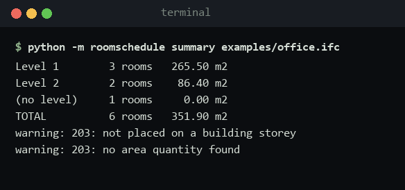

# bim-room-schedule-exporter

A room schedule is the list every facility team needs from the BIM model: room number, name, level and area. This repo reads an IFC file and writes that schedule as a CSV, with warnings for rooms that have no level, number or area.



## What it is for

Handover models often arrive as IFC files while the facility team works in spreadsheets. Facility coordinators and space planners use this tool to pull a clean room list out of the model without a BIM license, and to find rooms whose data is incomplete before the list is loaded into a space or maintenance system.

## Install

```
git clone https://github.com/yassine2med/bim-room-schedule-exporter
cd bim-room-schedule-exporter && pip install -r requirements.txt
```

## How to use

| I want to | Command |
|---|---|
| Print the room schedule as CSV | `PYTHONPATH=src python -m roomschedule export examples/office.ifc` |
| Write the schedule to a file | `PYTHONPATH=src python -m roomschedule export examples/office.ifc -o rooms.csv` |
| See rooms and area per level, plus warnings | `PYTHONPATH=src python -m roomschedule summary examples/office.ifc` |
| Fail (exit 1) when any room has a warning | `PYTHONPATH=src python -m roomschedule export examples/office.ifc --strict` |
| Show help | `PYTHONPATH=src python -m roomschedule --help` |

Example:

```
PYTHONPATH=src python -m roomschedule summary examples/office.ifc
```

Output:

```
Level 1        3 rooms   265.50 m2
Level 2        2 rooms    86.40 m2
(no level)     1 rooms     0.00 m2
TOTAL          6 rooms   351.90 m2
warning: 203: not placed on a building storey
warning: 203: no area quantity found
```

Run the tests with `python -m pytest -q`.

## How it works

1. The IFC text file is split into statements on semicolons outside quoted strings, and comments are removed.
2. Each `#id=IFCTYPE(...)` line is parsed into a type and a list of arguments (strings, numbers, enums, references, nested lists).
3. Spaces (`IFCSPACE`) are matched to a building storey through `IFCRELAGGREGATES` or `IFCRELCONTAINEDINSPATIALSTRUCTURE`.
4. Areas come from `IFCQUANTITYAREA` values named NetFloorArea, GrossFloorArea or Area, linked to the space through `IFCRELDEFINESBYPROPERTIES`.
5. Rooms are sorted by storey elevation, then room number. Missing level, area or number becomes a warning.

## Limits

- Reads IFC text files (.ifc) only. IFCZIP and IFCXML are not supported.
- Areas are read from quantity sets only; it does not compute geometry.
- Tested on the hand written sample in `examples/`. Large exports from authoring tools may use entity types this reader ignores.

## License

MIT. Yassine Emhamed, 2026.
